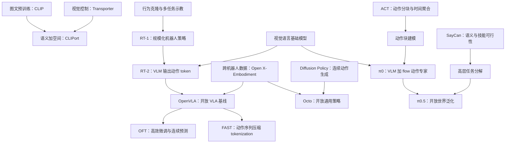

# VLA 领域地图

箭头表示学习依赖或方法思路的联系，**不表示所有后继都直接使用前者的代码或训练权重**。

## 六个方向如何区分

|方向|关键问题|代表论文|适合你在什么时候读|
|---|---|---|---|
|语言与规划|理解任务、选技能、分解长程目标|SayCan、Code as Policies、PaLM-E|发现「会说但不会做」时|
|离散动作 VLA|把动作变成 VLM 可以生成的 token|RT-2、OpenVLA、FAST|入门主线|
|连续动作生成|生成精细动作块、表达多峰行为|Diffusion Policy、ACT、π0、RDT-1B|主线的关键前置与扩展|
|通用与跨机器人|多个机器人如何共享经验、适配接口|RT-1、RoboCat、Octo、Open X-Embodiment|看预训练与迁移结论时|
|数据与评测|能力到底由哪些数据支持、如何证明泛化|BridgeData、DROID、LIBERO、CALVIN、SimplerEnv、RoboCasa|做任何实验前|
|效率与空间|控制时延、低成本、三维几何|OFT、SmolVLA、SpatialVLA、GR00T N1|确定后续研究切入点时|

这些类别会交叉。π0 同时是 VLA 与连续动作模型；FAST 是动作表示，不是一个仿真环境；Open X-Embodiment 是数据合作与模型研究，不是一种唯一动作头。

## 看见一篇新文章时的定位流程

先写出它的「输入 → 主干 → 动作头 → 控制接口」。再问：它主要改了数据、空间表示、动作表示、训练目标、微调，还是推理系统？最后检查实验是否固定其他变量。如果模型与数据都换了，仅靠总成功率不能确定改进来自哪里。
